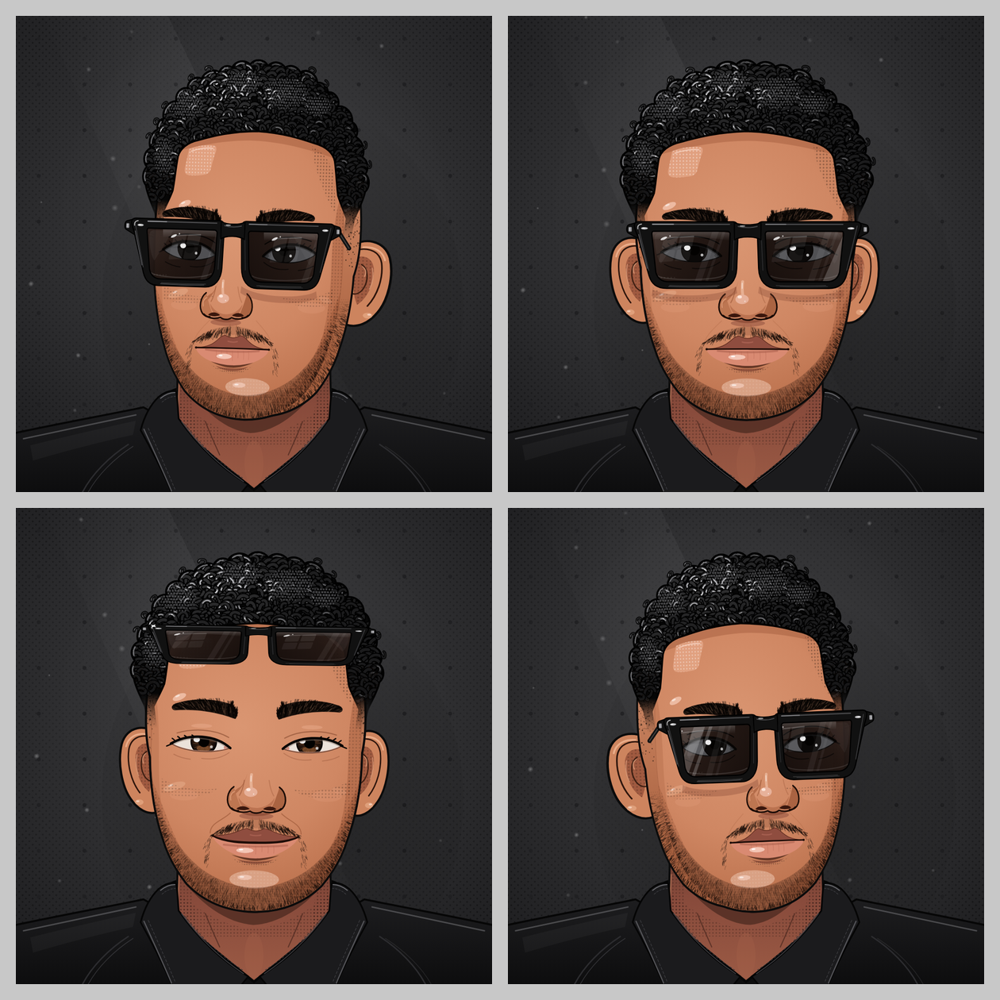

# Generation-video

## Personnage animé (`personnage-anime/`)

Portrait animé fait uniquement en **HTML + CSS + JavaScript** (aucune image externe) :
homme aux cheveux bouclés avec dégradé sur les côtés, lunettes de soleil noires,
barbe de quelques jours, chemise noire, style BD avec trames.



Ouvrir `personnage-anime/index.html` dans un navigateur (double-clic suffit).

### Ce qui est animé
- La tête et le regard suivent le curseur (ou le doigt sur mobile), avec un effet de volume « 2,5D ».
- Respiration, micro-mouvements, clignements naturels (parfois doubles).
- Reflets : fenêtre et traînées dans les verres, éclats sur la monture, étoile qui scintille,
  reflets de peau (front, nez, pommettes, menton, lèvre). La lumière est fixe : quand la tête
  tourne, les reflets glissent sur les surfaces.
- Détails : fibres de l'iris, cils, coin rose de l'œil, mèches qui dépassent, surpiqûres du col,
  dents séparées quand il parle, poussières en suspension et ombre portée dans le décor.
- Expressions : neutre, sourire, surpris, sérieux, clin d'œil.
- Gestes : relever/remettre les lunettes, oui/non de la tête, reflet qui balaie les verres.
- Angles de vue : 3/4 gauche, face, contre-plongée, 3/4 droite.
- Parole : bulle de BD + bouche animée, voix française du navigateur si disponible.

### Pilotage depuis la console (utile pour un montage vidéo)
```js
personnage.expression('sourire');   // neutre | sourire | surpris | serieux
personnage.pose('left');            // left | front | low | right
personnage.action('wink');          // wink | glasses | nod | shake | glint
personnage.parler('Bonjour !');
personnage.suivre(true);            // reprendre le suivi du curseur
```

### Fichiers
- `index.html` : structure SVG du personnage et panneau de commandes.
- `style.css` : mise en page, thème sombre, bulle de dialogue, responsive.
- `script.js` : textures procédurales (boucles, barbe, sourcils) et moteur d'animation.
